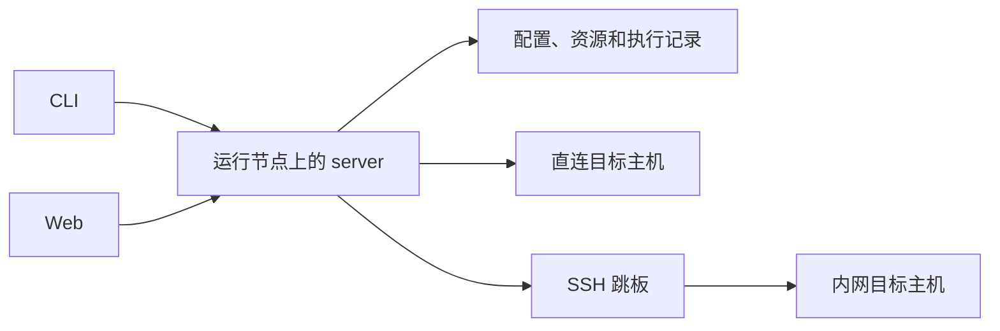

# deploy-crab 产品定位、任务能力与会话交互讨论纪要

整理日期：2026-11-13  
文档性质：前期讨论整理与设计草案

本文汇总关于 deploy-crab 的产品定位、运行模型、文件存储、任务编排、SSH 接入和会话交互的讨论。对于讨论中经过修正的观点，以最后统一的建议为准；仍需验证的方案明确标注为建议或待确认。

本文不是当前功能清单，也不代表所有设计已经实现。文末记录了整理时发现的仓库实现差异，后续开发应结合现有代码再做对齐。

## 1. 讨论方向与状态

| 主题         | 当前方向                                                         | 状态                                     |
| ------------ | ---------------------------------------------------------------- | ---------------------------------------- |
| 产品定位     | 面向一台或多台服务器的部署与操作工具，兼顾临时操作和长期环境管理 | 用户明确的目标                           |
| 操作入口     | CLI 和 Web 使用同一套能力、配置与执行记录                        | 用户明确的目标                           |
| 运行模型     | 一个运行节点负责管理数据、建立连接和执行任务                     | 已认可的方向                             |
| 任务体系     | 通用任务编排框架，上层提供各类现成模板                           | 用户明确认可                             |
| 自定义方式   | 表单组合能力，Shell 作为高级选项                                 | 用户明确选择                             |
| 初期存储     | 使用 YAML/JSON 和文件目录，暂不引入数据库                        | 用户明确的偏好                           |
| 日常使用形式 | 使用可持续恢复的工作会话，组织连续操作                           | 用户明确的目标                           |
| 会话切换环境 | 会话按工作目的组织；环境、主机可以切换；每次执行保留当时的上下文 | 最后一轮统一建议，待用具体界面进一步确认 |
| 初期执行后端 | 优先复用 OpenSSH，实现 Shell、文件下发等基础能力                 | 当前推荐路线                             |
| Ansible      | 作为后续可选执行后端，复杂部署时再评估引入                       | 当前推荐路线                             |
| 下一阶段     | 先讨论欢迎页、会话入口、主机与环境配置，再进入开发               | 用户明确的推进方式                       |

## 2. 产品定位与运行模型

### 2.1 一个运行节点，两个操作入口

deploy-crab 的运行节点是实际启动服务的那台机器，由它负责：

- 保存配置、模板资源、执行记录和日志。
- 建立 SSH 连接，处理跳板路径和文件传输。
- 组织并执行任务，维护运行状态。
- 向 CLI 和 Web 提供同一份业务状态。

CLI 提供终端交互和命令调用，Web 提供图形化操作与管理。用户希望借鉴的是 CLI/Web 双入口的使用形式，Web 可以自主设计。



### 2.2 运行位置与连接路径分别处理

运行节点可以是个人电脑，也可以是 bastion 或其他内网机器。产品不需要为此维护两套业务运行模式。

| 情况                                 | 从运行节点出发的连接路径                           |
| ------------------------------------ | -------------------------------------------------- |
| 目标可以直接访问                     | 运行节点 → 目标主机                                |
| 目标需要经过跳板                     | 运行节点 → 跳板 → 目标主机                         |
| deploy-crab 本身运行在内网或 bastion | 从该节点直接连接可达的目标，或使用它需要的跳板路径 |

浏览器通过 SSH 端口转发访问远程 Web，属于操作入口的接入方式；任务如何经 SSH 连接目标主机，属于执行侧连接路径。这两件事分别配置。

文件路径、SSH 密钥和 SSH agent 都以运行节点为准。浏览器所在电脑的文件或凭据，需要通过明确的导入或上传流程才能供运行节点使用。

server 管理已经发起的执行。关闭浏览器、切换会话或退出 CLI，不等于停止 server 上的执行；server 自身退出、运行节点休眠或连接中断时，则需要按中断规则处理。

## 3. 工作目录与文件存储

### 3.1 三类目录

| 概念               | 用途                                             |
| ------------------ | ------------------------------------------------ |
| 进程当前目录 `cwd` | 启动进程时所在的位置，不应决定默认业务数据的位置 |
| 实例数据目录       | 持久保存环境、主机、会话、模板资源、执行记录等   |
| 单次执行工作目录   | 保存该次执行下载、渲染或生成的工作文件           |

远端安装路径另由步骤指定，例如目标机器上的 `/opt/order-service/compose.yaml`，与运行节点的数据目录分别管理。

### 3.2 当时讨论的目录约定

| 场景       | 讨论中的约定                                           |
| ---------- | ------------------------------------------------------ |
| 开发模式   | `<仓库根目录>/.deploy-crab/`，加入 Git 忽略            |
| 正常使用   | `~/.deploy-crab/`，其中 `~` 指运行节点当前用户的主目录 |
| 自动化测试 | 为测试创建独立临时目录                                 |

开发模式重启后继续使用同一份开发数据。monorepo 中不同应用的 `cwd` 可能不同，应统一解析数据根目录，再由 server 管理实际读写。

目录覆盖规则曾建议为“显式启动参数 → 环境变量 → 默认目录”。具体参数名和实现方式仍需与现有代码对齐，不能据此认为 `--data-dir` 等参数已经存在。

以下是结合本轮会话模型整理的目录示意，具体布局尚未定稿：

```text
实例数据目录/
├── config.yaml
├── hosts/                          # 独立保存的主机连接资料
├── environments/                   # 环境及其主机引用、分组、相关配置
├── sessions/                       # 工作会话及操作索引
├── templates/                      # 可复用流程和版本化资源
│   └── <模板ID>/<版本>/
│       ├── template.yaml
│       └── assets/
├── runs/
│   └── <执行ID>/
│       ├── run.json
│       ├── logs/
│       └── work/
├── cache/
└── runtime/
```

初期建议用 YAML 保存可编辑配置、JSON 保存执行元信息、独立日志文件保存输出。Web 和 CLI 的业务修改统一通过 server 写入，同一数据目录由一个 server 实例负责写入；文件更新采用原子替换等必要保护。

### 3.3 与当前仓库的差异

2026-11-13 整理时，现有代码与文档采用的是：

- 环境变量：`DATA_DIR`。
- 开发默认目录：仓库根目录 `.data/`。
- 生产默认目录：后端交付目录中的 `data/`。
- 显式设置相对 `DATA_DIR` 时，按进程启动工作目录解析；默认目录按模块位置计算。

这与上面的讨论约定不同，需要在后续开发前明确保留哪一套，或规划迁移。本文没有修改当前实现。

参见 [core 现有实现](../packages/core/src/index.ts)、[core 说明](../packages/core/README.md)及[项目中文说明](../README.zh-CN.md)。

## 4. 环境、主机与 SSH 跳板

### 4.1 主机可以独立存在

主机不要求先归属某个环境。使用时可以有三种情况：

1. 临时填写连接信息，本次使用，不保存为长期主机资产。
2. 保存为常用主机，但暂不加入环境。
3. 把已保存主机加入环境，由环境组织主机、分组和相关配置。

环境通过引用组织主机。临时主机后续可以保存、加入环境，原有执行历史继续保留当时的信息。

这里的“环境”是一组管理对象，例如测试环境、生产环境；不要求它本身是 Kubernetes 集群。一个环境可以容纳不同用途的机器或主机组。

### 4.2 第一版连接设置保持简单

每台主机保存地址、SSH 端口、登录用户、认证引用等信息。连接方式先提供：

- 直接连接。
- 经过指定 SSH 跳板连接。

例如：

| 主机    | 地址             | 连接方式     |
| ------- | ---------------- | ------------ |
| jump-01 | 可访问的公网地址 | 直接连接     |
| app-01  | `10.0.0.11`      | 经过 jump-01 |

连接 app-01 时，实际路径为：

```text
deploy-crab 运行节点 → jump-01 → app-01
```

命令和文件操作最终作用于选定目标。路径中的跳板不会自动成为部署目标。

bastion 是某台主机在连接路径中承担的角色，不必作为互斥的主机类型或环境类型。它也可以被单独选中执行维护任务。

### 4.3 可扩展项与执行约定

- Shell、文件传输和连接检查应使用同一套路径解析逻辑。
- 跳板和目标主机可以使用不同的用户与认证信息。
- 执行前检查跳板引用是否存在、是否引用自身或形成循环。
- 连接检查应能区分跳板登录、目标网络连通和目标认证等阶段。
- 多套命名接入配置、环境默认值和主机覆盖，可以等确实需要频繁切换入口网络时再引入。
- 多跳可以在数据结构上预留，第一版界面先支持直连和单跳。

## 5. 会话式工作方式：最后统一的模型

### 5.1 会话围绕工作目的组织

用户希望像持续工作的终端或会话工具一样使用 deploy-crab：打开已有会话继续处理问题，也可以为另一件工作新建会话。

工作会话是连续工作的容器，可以包含目标选择、命令、文件操作、任务执行、结果和排查过程。它与 SSH 终端连接是不同概念。

| 对象     | 职责                                     |
| -------- | ---------------------------------------- |
| 环境     | 长期组织机器和相关配置                   |
| 主机     | 保存连接信息，或作为本次操作的临时目标   |
| 会话     | 组织围绕一个工作目的的连续操作           |
| 执行记录 | 保存某次动作的实际目标、参数、过程和结果 |
| 模板     | 保存可以复用的操作流程和参数定义         |

### 5.2 环境和目标可以切换，执行记录保持固定

会话可以不关联环境，也可以有一个当前环境。会话中的环境和主机选择用于后续操作，不用于重新解释历史记录。

讨论曾提出“会话开始执行后固定环境”，后来因其与会话内更换目标主机的处理逻辑不一致，撤回了这项硬性限制。最后统一建议为：

> 会话按工作目的组织，环境和主机是可切换的操作上下文。每次执行固定保存当时的环境、目标和参数。

例如，同一个“订单服务 2.4.1 发布”会话：

| 执行 | 当时的环境 | 当时的目标       | 操作       |
| ---- | ---------- | ---------------- | ---------- |
| #101 | 测试环境   | test-01、test-02 | 部署并验证 |
| #102 | 生产环境   | prod-01、prod-02 | 部署       |
| #103 | 生产环境   | prod-02          | 排查日志   |

切换环境后，需要重新确定目标主机、环境配置和凭据引用等。进行中的执行继续使用发起时的配置，已经完成的记录保持原来的环境和目标。

### 5.3 一个环境的 12 台机器可以分次操作

环境包含 12 台机器，不代表会话的每次操作都作用于 12 台。用户可以在同一会话中更换当前选择：

| 执行 | 目标                   | 操作     |
| ---- | ---------------------- | -------- |
| #201 | app-01、app-02、app-03 | 下发配置 |
| #202 | app-04、app-05、app-06 | 下发配置 |
| #203 | app-02                 | 查看日志 |

每次执行的目标在发起时保存。改变会话当前选择，不改变任何已有执行的目标。

### 5.4 记录管理采用不同视图，保持一份记录

| 查看位置   | 展示内容                                 |
| ---------- | ---------------------------------------- |
| 会话页     | 这段工作的完整操作时间线，可涉及多个环境 |
| 环境页     | 按每条执行记录当时的环境，汇总相关执行   |
| 主机页     | 与该主机有关的执行记录                   |
| 全局执行页 | 跨会话、跨环境的执行记录和正在运行的任务 |

这些页面引用同一条执行记录，不复制多份，也不因会话当前环境变化而迁移记录。

会话列表独立于环境列表。一个会话涉及多个环境时，不能只根据它当前选择的环境来推断全部历史的归属。

### 5.5 防止混淆的交互规则

- 会话顶部固定展示当前环境、选中主机、数量和连接路径。
- 执行按钮明确展示作用数量，例如“在这 3 台主机上执行”。
- 每张执行卡片展示它自己的环境、目标和逐机结果。
- 环境切换在时间线上形成明确的上下文分隔。
- 浏览其他环境的管理页面，不隐式修改当前会话的执行目标。
- “筛选历史记录”和“选择执行目标”使用不同控件。
- 任务进度继续更新到原执行记录，切换会话不会改变它的归属或目标。

## 6. 欢迎页与日常交互

### 6.1 欢迎页以开始或继续工作为主

主入口建议为：

- 继续最近会话或选择已有会话。
- 开始新会话。
- 管理环境与主机。

新会话可以选择环境，也可以直接选择已保存主机或临时输入连接信息。无需先填写会话名称、创建环境才能完成一次操作；系统可以自动创建临时会话，之后再重命名。

### 6.2 临时操作主机

```text
新建会话
→ 连接主机
→ 选择已保存主机，或临时填写地址、用户和认证信息
→ 需要时填写端口、SSH 跳板
→ 检查并使用
→ 在同一会话里执行命令、下发文件、查看结果
```

临时只表示未保存成长期主机资产。会话和执行历史继续保留。需要复用时再保存主机，需要组织管理时再加入环境。

恢复会话时，应恢复工作记录和必要的上下文；SSH 连接可按需重新建立，必要时重新认证。应用会话的连续性不等同于维持同一个远端 Shell 进程。

### 6.3 配置环境

```text
创建环境
→ 填写名称、描述
→ 添加新主机或选择已有主机
→ 按用途分组
→ 检查连接
→ 从该环境开始一个会话
```

环境配置保存与连接检查结果应分开处理，连接失败时保留用户已经填写的资料，便于修正。

### 6.4 会话工作页

Web 的建议布局：

- 左侧：会话列表，以及环境、主机等资源入口。
- 顶部：会话名称、当前环境、目标主机和连接路径。
- 中间：操作卡片、输出、文件和执行进度组成的时间线。
- 底部：命令输入，以及下发文件、运行模板等能力入口。

CLI 使用相同的业务概念，通过终端选择与输入完成操作。CLI 发起的同一次执行可以在 Web 中查看，反向也一样。

### 6.5 命令执行和交互式终端

用户明确表示两种都需要，优先做好有明确结果的命令执行和文件下发。

| 需求                              | 对应交互             |
| --------------------------------- | -------------------- |
| 执行命令，获取输出和退出码        | 发起一次执行         |
| 连续排查主机，查看多次操作        | 使用同一个工作会话   |
| 持续输入命令，保留 Shell 进程状态 | 打开交互式 SSH 终端  |
| 反复完成一套操作                  | 运行保存的任务或模板 |

交互式终端可以后续作为会话中的工具入口加入，其连接生命周期与自动化执行的生命周期分别管理。

## 7. 通用能力、复合能力与任务模板

### 7.1 核心理念

> 底层采用通用任务编排框架，上层提供各类现成模板。

“内置/自定义”描述由谁提供能力；“基础/复合”描述能力如何构成。这两个维度分别处理。

| 层次         | 职责                                             | 示例                                      |
| ------------ | ------------------------------------------------ | ----------------------------------------- |
| 基础能力     | 完成一个明确动作                                 | Shell、下载文件、下发文件、检查端口       |
| 复合能力     | 封装多个动作或专用协调逻辑                       | 准备镜像、部署 Compose 应用、部署 MongoDB |
| 任务模板     | 定义对外参数、目标要求、步骤和运行规则           | 安装应用、更新配置、收集日志、初始化环境  |
| 具体任务配置 | 将模板应用于某个环境或目标，保存可重复使用的配置 | 测试环境的订单服务部署                    |
| 执行记录     | 保存某次运行的实际快照和结果                     | 第一次部署、更新版本后的再次执行          |

临时操作可以直接形成执行记录，无需先保存成长期任务。需要复用时，再保存为任务或模板。

### 7.2 组合包括顺序与数据传递

能力需要声明输入、输出、目标要求和成功条件。步骤之间既能按顺序执行，也能传递结果，例如：

- 下载文件的输出，作为下发文件的来源。
- 下发文件的远端路径，作为导入镜像步骤的输入。
- MongoDB、Redis 部署输出的连接信息，作为应用配置的输入。
- 当前主机的端口、目录等配置，参与生成该主机的 Compose 文件。

参数来源可以是固定值、任务参数、环境/主机配置或前面步骤的输出。常用引用通过选择器完成；Shell 保留为高级能力。

### 7.3 编排与使用分别设计

模板作者负责定义参数、添加能力、绑定目标和结果、决定开放给使用者的字段。

模板使用者填写开放出来的参数，预览后执行。Web 表单和 CLI 引导应基于同一份参数定义生成，并由 server 使用一致规则校验。

已有能力范围内的流程调整，通过配置完成。新的底层协议、动作或原生集成，仍需实现相应执行器或适配器。

初期建议先做好顺序步骤、按主机执行的步骤组、参数引用和失败停止，再按实际需求扩展更复杂的编排。

## 8. 文件来源、模板资源与下发路径

### 8.1 添加文件与下发文件是两个动作

| 操作               | 文件流向                             |
| ------------------ | ------------------------------------ |
| 编辑模板时添加文件 | 保存到运行节点，成为模板资源         |
| 执行任务时下发文件 | 从运行节点传到选定目标主机的指定路径 |

模板可以自带 `compose.yaml`、`install.sh` 等资源，使用者无需每次提供。内置模板资源可以随应用分发，用户创建的模板资源保存在实例数据目录。

“下发文件”步骤的来源可以选择：

- 模板自带资源。
- 使用者运行任务时提供的文件。
- 前面步骤下载或生成的文件。

目标则独立指定主机和远端路径。例如：模板资源 `install.sh` → 应用主机组 → `/opt/order-service/install.sh`。

配置模板可以先按环境和主机参数渲染，再下发生成结果。原始模板继续保留。

### 8.2 复用与版本

需要跨模板共用的文件，可以后续扩展为共享资源。初期先围绕模板资源实现即可。

执行应固定使用的模板与资源版本。修改模板或文件，不改变已经开始的执行及历史记录。具体采用内容摘要、版本目录还是其他资源标识，尚未确定。

## 9. 实际案例：从制品库安装 Compose 应用

### 9.1 用户描述的当前情况

- 制品库目前提供 Generic Release 形式的 `tar.gz` 文件。
- 这些文件是 Docker 镜像归档，计划下载后通过 `docker load` 导入。
- Compose 文件不在镜像归档里，由用户另外组织到各台机器上。
- 当前每台服务器独立运行 Docker Compose，暂不按 Kubernetes 场景设计。
- 后续希望支持从镜像仓库在线拉取，并保留扩展 Kubernetes 的可能。

这里的镜像归档应是可供 Docker 加载的镜像归档，具体发布格式与镜像清单仍需验证；不能仅凭 `tar.gz` 扩展名推断包内内容。

### 9.2 分开处理镜像、配置和部署过程

| 部分     | 当前形式                             | 可扩展方向                 |
| -------- | ------------------------------------ | -------------------------- |
| 镜像来源 | 制品库中的镜像归档                   | 镜像仓库引用、在线拉取     |
| 部署配置 | 独立维护的 Compose 文件和参数        | 多套配置模板、按主机覆盖   |
| 部署过程 | 分发归档、导入、下发配置、启动和检查 | 对应新来源或目标的部署能力 |

讨论中的应用安装过程为：

```text
运行节点准备镜像来源
→ 对选定应用主机逐台执行完整过程：
  分发并导入镜像，或在线拉取镜像
  → 生成并下发 Compose 文件与应用配置
  → 启动服务
  → 检查就绪
→ 汇总逐机结果
```

“逐台部署”指一台机器完成整段流程后，再进入下一台。若采用其他策略，也应在任务规范中明确。

Compose 配置可以先采用“共用模板 + 环境参数 + 主机覆盖”；服务结构不同的主机组可以使用不同模板。具体配置来源和编辑方式仍待通过样例确认。

发布版本需要与镜像名称、标签或其他可验证标识建立对应关系。一个归档可能包含多个镜像，镜像准备的结果应确认应用所需镜像可用，且与 Compose 引用一致。

以后支持 Kubernetes，需要提供对应的部署能力、配置格式与镜像分发策略；不把目标主机上的 Docker 导入流程直接视为通用的 Kubernetes 镜像准备方式。

### 9.3 更大流程的组合

“初始化业务环境”可以组合：

```text
在数据库主机组部署 MongoDB
→ 在缓存主机组部署 Redis
→ 将连接信息交给应用配置
→ 在应用主机组安装 Compose 应用
```

不同步骤可以选择不同主机组。日常更新应用时，可以直接复用应用安装流程，而不必重新运行整个初始化过程。

## 10. 执行记录、重复运行与中断

### 10.1 一次执行一条独立记录

长期任务可以有固定任务标识，每次执行产生新的执行标识。临时操作也有独立执行记录，可不关联长期任务。

每次执行至少需要保留：

- 所属会话，以及发起时的环境（可为空）。
- 实际目标主机和解析后的连接路径。
- 使用的能力、模板、资源版本，以及参数的必要快照。
- 状态、时间、逐机结果和日志。
- 如属重试，与原执行的关联关系。

凭据保留必要引用，不在普通执行快照中复制密码或私钥。

### 10.2 已讨论的行为建议

| 情况                                 | 建议行为                                         |
| ------------------------------------ | ------------------------------------------------ |
| 相同配置再次运行                     | 新建执行记录，重新检查实际状态                   |
| 修改任务后运行                       | 保存新的配置快照，原记录不变                     |
| 用户双击、网络重发同一提交           | 通过提交标识等机制避免重复创建执行               |
| 部分主机失败后重试                   | 新建关联记录，依据依赖与真实状态确定范围         |
| 执行期间编辑模板、切环境或换目标     | 已开始执行继续使用原快照                         |
| 浏览器关闭或 CLI 退出，server 仍运行 | 执行继续，由原记录承载进度                       |
| server 退出或连接中断                | 标记中断或结果待核实，重新检查后再决定后续动作   |
| 停止执行                             | 停止后续动作并尝试终止当前动作，已完成的变更保留 |

重试不等于无条件重跑所有安装步骤，停止也不等于回滚。第一版不承诺自动断点恢复或通用自动回滚。

并发限制、跨任务资源锁、重试入口和精确状态集合仍待实现设计。此前提出过同一任务避免并发执行、涉及同一主机变更时排队等保守策略，尚未形成最终调度规范。

## 11. 直接 SSH 执行与 Ansible

### 11.1 当前推荐路线

第一版优先直接复用 OpenSSH 等成熟实现，完成连接检查、Shell、文件下发和当前 Compose 场景。应用负责能力封装、步骤组织和结果管理，不自行实现 SSH 协议。

主要考虑是先验证自定义任务、CLI/Web 和会话交互，避免在基础能力阶段同时承担 Ansible 转换层与 Python 执行环境的接入成本。

这条路线也意味着我们需要实现和维护逐机状态、输出、超时与必要的执行控制，不能把直接 SSH 理解为完整自动化能力已经具备。

如果后续需要大量跨发行版的软件安装、服务与配置管理，或已有 Playbook 可复用，则重新评估 Ansible 的收益。

### 11.2 使用 Ansible 不要求用户预先维护完整 Playbook

可选接入方式为：

```text
用户组合 deploy-crab 能力
→ 保存 deploy-crab 自己的任务定义
→ 适配层根据步骤生成 Playbook、主机清单、参数和资源
→ 调用 Ansible / Ansible Runner
→ 将执行事件映射回原步骤和主机
```

例如，文件下发可以映射到 `copy`，Shell 映射到 `shell`，等待端口映射到 `wait_for`。MongoDB、Redis 等复杂能力可以由维护的 Role 实现。

固定维护的是能力实现与映射规则；用户选择的顺序、参数和目标决定最终生成的流程。自动转换和结果映射需要我们开发，不是 Ansible 会自动理解 deploy-crab 的任务定义。

Ansible 的控制端依赖 Python；应用本身可以继续使用 TypeScript，通过子进程调用执行工具。目标主机无需安装 Ansible，但常见 Linux 模块通常需要目标机具备 Python，部分直接命令和脚本模块例外。

### 11.3 源码内容与运行产物分开

| 内容                                           | 位置与维护方式                      |
| ---------------------------------------------- | ----------------------------------- |
| 内置 Role、静态任务片段、能力映射代码          | 源码仓库维护，随应用版本发布        |
| 用户自定义任务与附件                           | 实例数据目录，用户通过 CLI/Web 配置 |
| 单次执行的入口 Playbook、inventory、参数和事件 | 该次执行目录，由系统生成和管理      |

可选的目录示意：

```text
packages/executor-ansible/
├── src/
└── resources/roles/

实例数据目录/runs/<执行ID>/ansible/
├── project/
│   ├── playbook.yml
│   └── roles/
├── inventory/
├── env/
└── artifacts/
```

发布后从应用包取得所需能力实现，不依赖开发源码目录。执行所用能力与资源版本需要固定。

修改 MongoDB 安装逻辑，可能需要修改仓库并发布版本；用户新增“MongoDB → Redis → Shell”组合，可以只保存新的任务定义。

是否接入 Ansible、以完整流程还是特定复杂能力作为接入边界，以及版本和分发方式，仍待实际样例验证。当前不计划同时完整实现两套后端。

## 12. 开发顺序与本轮讨论范围

建议每轮先完善共用业务与 server，再由 CLI 打通实际路径，Web 紧接着接入。以两端能操作并看到同一份状态作为阶段目标。

| 阶段           | 建议内容                                                       |
| -------------- | -------------------------------------------------------------- |
| 交互确认       | 欢迎页、会话入口、环境与主机选择、切换上下文和记录归属         |
| 第一轮基础能力 | 主机与环境资料、直连和单跳配置、连接检查                       |
| 第二轮         | Shell 执行、统一执行记录、输出和退出码                         |
| 第三轮         | 模板文件资源、运行时文件输入、文件下发                         |
| 后续           | 参数绑定、顺序编排、Compose 镜像归档安装                       |
| 再后续         | 复杂部署、可选 Ansible、在线镜像仓库、Kubernetes、交互式终端等 |

该顺序是讨论中的推进建议，不是对现有仓库功能完成度的判断。

整理时，当前仓库已有 Web 与构建等方面的后续改动，目录中未见 `apps/cli`。早期讨论中“CLI 已有 Ink 启动壳、Web 仍为默认页面”的描述只代表当时的观察，不能作为今天的实现状态。

当前仓库的 `packages/core` 包含 Node.js 文件系统逻辑，不能直接供浏览器导入。后续共享的任务类型、校验或纯函数，应遵循现有仓库对浏览器兼容包的边界约定。

## 13. 仍需进一步确认的事项

1. 欢迎页的最终布局，以及首次进入、继续会话、新建会话的具体交互。
2. 会话跨环境时的顶部控件、上下文分隔、草稿参数重置和历史筛选方式。
3. 临时连接、保存主机、加入环境三个动作的具体入口。
4. 主机标识、环境成员关系、分组与临时目标的最终存储格式。
5. 数据目录采用现有 `.data/` 与 `DATA_DIR`，还是迁移到讨论的 `.deploy-crab/` 约定。
6. 首版 SSH 调用方式、认证交互、主机指纹处理、超时和连接复用策略。
7. 能力与模板的最小规范、版本策略、类型校验、输入输出绑定方式。
8. 执行状态、停止、重试、并发和主机资源协调的具体规则。
9. Compose 模板的编辑来源、逐机参数覆盖、镜像清单及就绪检查标准。
10. 接入 Ansible 的实际触发条件，以及后续镜像仓库、Kubernetes 的适配边界。

这些事项需要在具体交互和实现样例中继续确认，不能把本文所有示意字段和目录直接视为最终接口。

## 14. 讨论中已经修正的理解

| 早期理解或方案                             | 本文采用的整理口径                                 |
| ------------------------------------------ | -------------------------------------------------- |
| 必须先创建环境才能操作机器                 | 支持临时目标和独立保存的主机，环境可选             |
| 会话只表示 SSH 终端连接                    | 会话是连续工作的容器，终端是其中一种工具           |
| 会话必须归属于单一环境，切环境必须另建会话 | 最后一轮建议允许切换环境；固定的是每次执行的上下文 |
| 会话当前目标可以决定历史记录显示为什么机器 | 每次执行保留自己的目标，当前选择只影响后续操作     |
| bastion 对应独立运行模式或互斥主机类型     | 使用一个运行模型，跳板是连接路径中的角色           |
| 自定义任务意味着用户必须先写固定 Playbook  | 如接入 Ansible，可由平台根据自定义任务生成执行文件 |

## 15. 参考资料

以下资料在讨论中用于核对成熟工具的行为与运行要求。本文的会话、数据目录和产品交互是针对 deploy-crab 的建议，不把它们表述为这些工具规定的统一行业标准。

- [OpenSSH：ProxyJump 与 SSH 配置](https://man.openbsd.org/ssh_config#ProxyJump)
- [Ansible：主机清单、分组和连接参数](https://docs.ansible.com/projects/ansible/latest/inventory_guide/intro_inventory.html)
- [Ansible：临时操作](https://docs.ansible.com/projects/ansible/latest/command_guide/intro_adhoc.html)
- [Ansible：Playbook 结构与执行](https://docs.ansible.com/projects/ansible/latest/playbook_guide/playbooks_intro.html)
- [Ansible：Role 组织与复用](https://docs.ansible.com/projects/ansible/latest/playbook_guide/playbooks_reuse_roles.html)
- [Ansible：控制节点与受管节点的安装要求](https://docs.ansible.com/projects/ansible/latest/installation_guide/intro_installation.html)
- [Ansible Runner：输入目录、执行事件和结果](https://docs.ansible.com/projects/runner/en/stable/intro/)
- [Docker：加载镜像归档](https://docs.docker.com/reference/cli/docker/image/load/)
- [Docker Compose：拉取服务镜像](https://docs.docker.com/reference/cli/docker/compose/pull/)
- [Docker Compose：启动服务](https://docs.docker.com/reference/cli/docker/compose/up/)
- [VS Code Remote-SSH：连接并保存主机](https://code.visualstudio.com/docs/remote/ssh)
- [前序聊天：记录 deploy-crab monorepo 初始化](codex://threads/01a1aaa5-fd94-7732-bc64-d69e314bcc5a)
